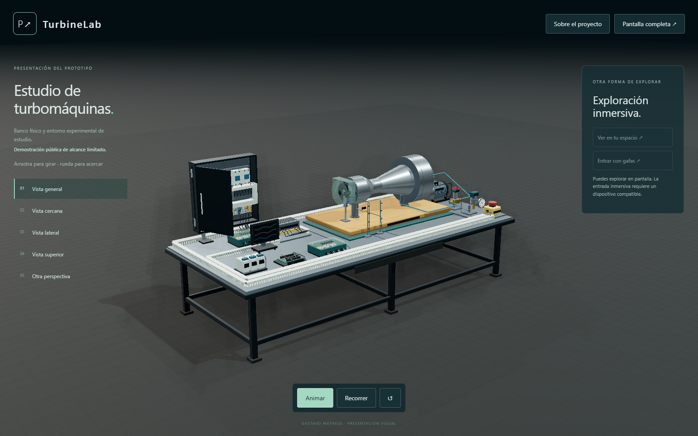

# TurbineLab

*Experimental turbomachinery, instrumentation and interactive study*

TurbineLab is an experimental instrumentation project centred on a physical turbine prototype. It combines a mechanically assembled bench with a private environment for modular experimentation, programming and analysis of simulated behaviour.

> **Public demonstration — limited scope**
> This repository presents a selected overview of the project. The displayed installation is a deliberately limited representation; it does not include the complete study environment or disclose the engineering implementation. Component identification, connection designs and detailed technical documentation remain private.

[Explore TurbineLab](https://gmprospect.github.io/turbinelab/)

## Experimental platform

The project has a physical basis: the prototype has been mechanically assembled. The wider development combines this experimental platform with software tools for investigating behaviour, configuring study scenarios and interpreting simulated observations.

The study tools allow different operating scenarios to be configured, programmed and examined. Physical assembly and software experimentation are documented separately so that simulated results are not presented as measurements from the real installation.

## Study and development capabilities

The private study environment includes:

- **Modular experimentation:** configurable assemblies and study scenarios for exploring the behaviour of an experimental installation.
- **Programming and interaction:** programmable experiments and interactive responses within the simulated environment.
- **Observation and analysis:** inspection of simulated responses, graphical analysis and review of experimental records.
- **Engineering development:** detailed project documentation and internal verification of the implemented study tools.

These capabilities belong to the private development environment. They are described here at project level; their implementation, configuration procedures and complete tools are not distributed in this repository.

## Public experience

The browser-based demonstration provides a visual overview of the installation, illustrative motion and spatial exploration. Desktop navigation and compatible immersive viewing allow the installation to be examined from different perspectives. The public experience accompanies the experimental project; it is not its full technical distribution.

The motion and graphical responses shown publicly are illustrative. They are not live measurements from the physical bench, do not control the equipment and do not demonstrate measured electrical generation.

## Publication boundary

The selection and identification of components, detailed specifications, engineering drawings, connection designs, programming implementation, complete study tools and development records are retained privately to protect the project's intellectual work. No assembly instructions, technical inventory or complete-project export is provided by the public demonstration.

The public visual assets are necessarily delivered to the browser for display. Their availability does not constitute publication of the complete engineering design, and the absence of an export button does not prevent extraction of the displayed representation. Third-party software retains its own licence terms, listed with the demonstration.

## Verification scope

The physical status reported here is mechanical assembly. The software environment and the public presentation have separate verification records in the private development repository. Immersive interaction has been tested with an emulated headset and controllers; physical-headset testing is not claimed.

## Authorship

**Gustavo Matheus** ([GMProspect](https://github.com/GMProspect)) — Instrumentation Specialist and Embedded Systems Developer.
